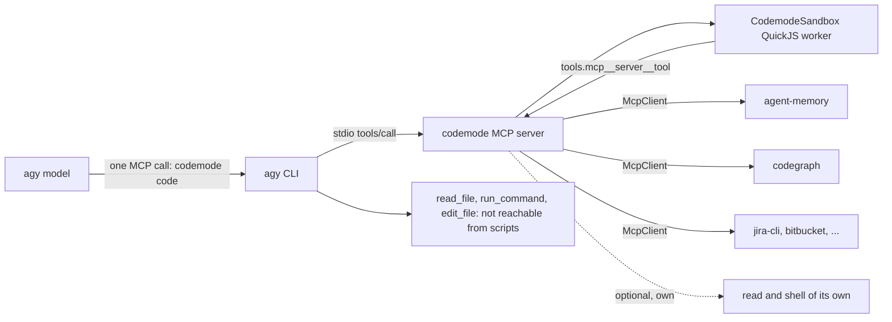

# 0003. Codemode for the Antigravity CLI as an MCP server, and what agy already defers

## Question

Can the codemode tool of this repository reach the Antigravity CLI (`agy`), which has no mods API, as an MCP server? The question has five parts: (1) does `@earendil-works/pi-codemode`, or Pi's codemode, already ship an MCP-server mode; (2) what a codemode MCP server would look like and what it cannot reach inside `agy`; (3) what `agy` puts in the model's context for MCP tools, so the token gain is measured; (4) whether the same server serves Codex and OpenCode; (5) effort, risks and options. Research only: no decision is taken here.

## Method

Read and run on 2026-11-26 on Linux. Every finding names its evidence in [Sources](#sources).

- `@earendil-works/pi-codemode` 1.1.0, the version this repository pins (`package.json`), read from the installed copy of the codemode plugin 0.7.3; Pi 1.6.0 (`pi-codemode`, `pi-mcp`, `pi-coding-agent` 1.6.0) read from `~/.pi/agent/install/releases/1.6.0/node_modules/@earendil-works/`.
- `agy` 1.5.17: `agy --help`, `agy mcp add --help`, the bundled customization docs in `~/.gemini/antigravity-cli/builtin/skills/agy-customizations/docs/`, the published CLI reference, `strings` over the `agy` binary, the schema files `agy` writes under `~/.gemini/antigravity-cli/mcp/`, and one print-mode probe (below). No `agy` database was opened.
- Codex CLI 0.167.0: `codex features list`, `codex mcp --help`.
- OpenCode 1.19.5: `opencode mcp --help`, the type declarations of `@opencode-ai/plugin` 1.19.5 in `~/.config/opencode/node_modules/`.

The probe, run in this repository with the MCP servers that se-configs renders for `agy` (active-collab, bitbucket, jira-cli, qa-walkthrough, agent-memory, codegraph):

```sh
agy -p "Do not call any tool. 1) Quote verbatim the whole <mcp_servers> block of your system prompt, if any. 2) List the exact name of every function tool you are given as a callable function declaration (names only, comma-separated). 3) Say whether any MCP tool's JSON schema is present in your context right now." --output-format json --print-timeout 200s
```

The probe's answers 1 to 3 are the model's own report of its context. The `usage` numbers come from `agy` itself.

## Findings

| # | Finding | Evidence | Confidence |
|---|---|---|---|
| 1 | `pi-codemode` has no MCP-server mode, in 1.1.0 or 1.6.0. It is a library: `CodemodeSandbox` runs a script in QuickJS (WebAssembly) in a worker thread, and the host injects each tool as an `execute` function. The README says it "can be used on its own to expose any functions (remote APIs, MCP servers, application services)". | [1] lines 3–5, 9–36; [2] | high |
| 2 | Pi ships no MCP server either. `pi-mcp` is "a small, standalone Model Context Protocol client" (stdio, Streamable HTTP, pipe transports). `pi mcp` only edits Pi's `mcp.json` (`add`, `remove`, `list`, `login`, `logout`). | [3] line 3; [4] lines 18, 341–348 | high |
| 3 | The building blocks for a server exist: `CodemodeSandbox` for the script, `renderDeclarations()` and `MCP_TYPESCRIPT_PREAMBLE` for the typed `tools.*` description, `pi-mcp`'s `McpClient` for the downstream servers. Pi's own `mcp-codemode` example combines codemode with MCP tools, but inside a Pi agent, not as a server. The MCP server side (stdio JSON-RPC, `tools/list`, `tools/call`) is not in any Pi package and must be written or taken from another SDK. | [1] lines 99–113, 161; [3] lines 9–26 | high |
| 4 | `agy` has no mods API and no in-process tool registration. A plugin carries `plugin.json`, `mcp_config.json`, `hooks.json`, `rules/` and `skills/`. MCP servers run over stdio or Streamable HTTP. A plugin's tools are namespaced. | [5] lines 8–23, 48–71; [6] lines 16–25, 52–74 | high |
| 5 | `agy` splits MCP tools into **Eager** and **Lazy**. The system prompt holds a `<mcp_servers>` block: "Each MCP server has a directory `<appDataDir>/mcp/<serverName>` containing tool schemas (`<toolName>.json`) and optionally an `instructions.md` file", then each server's tools under `Eager:` and `Lazy:`. A lazy tool is called through `call_mcp_tool`, whose description is "Call a lazy-loaded MCP tool. Read the tool's schema file to understand the tool's arguments and usage." This is a file-based form of Claude Code's ToolSearch deferral: the model reads the schema file, then calls. | probe [7]; `strings` over the binary [8] | high |
| 6 | Today every one of the 25 MCP tools se-configs renders is **Eager**: each is declared as a function `mcp_<plugin>_<server>_<tool>` with its full schema, and no tool is listed as `Lazy:`. 42 function tools in total; 15 of them are `agy`'s own (`read_file`, `run_command`, `write_file`, `edit_file`, `search_web`, `invoke_subagent`, …). | probe [7] | high |
| 7 | Measured weight: a one-turn probe that calls no tool costs **24,611 input tokens**. The 25 MCP schema files `agy` wrote weigh **31,261 bytes**, about **7,800 tokens** at 4 bytes per token (an estimate, not a tokenizer count): qa-walkthrough 11,044 bytes, agent-memory 10,013, active-collab 3,760, jira-cli 2,423, bitbucket 2,417, codegraph 1,604; the six `instructions.md` add 2,676 bytes. So MCP schemas are about a third of `agy`'s fixed context here (inference from the two numbers). | probe `usage` [7]; `wc -c` over `~/.gemini/antigravity-cli/mcp/*/*.json` [9] | high (bytes), medium (tokens) |
| 8 | The switch is per tool. The binary's MCP config type has a per-server `tools` map whose value is `{ background, eager }` (`json:"eager,omitempty"`), plus `disabledTools` and `McpToolConfig.enable_lazy_load`. The bundled docs and `agy mcp add --help` document neither. That `"tools": { "<tool>": { "eager": false } }` in a plugin's `mcp_config.json` moves a tool to `Lazy:` is an **inference, not run**. | `strings` [8]; [5]; [10] | medium |
| 9 | A nested call made by an MCP server to another MCP server bypasses `agy`: `agy`'s `toolPermission` prompts ("prompts for write, bash, web, and MCP tools unless an allow rule covers them") and its `PreToolUse`/`PostToolUse` hooks see one `codemode` call, never the nested ones. The server cannot call `agy`'s own tools (`read_file`, `run_command`, `edit_file`, the browser and subagent tools); MCP gives a server no path back to its client's tools. `agy acp` serves the Agent Client Protocol to a client and is not a tool bridge. | [11] line 175; [12]; `agy --help` [10] | high (prompt and hook scope), medium (no path back, inference from the MCP model) |
| 10 | Codex 0.167.0 already has code mode natively: `code_mode` (under development, **enabled**), `code_mode_host` (stable, enabled), `code_mode_tool_search` and `code_mode_only` (under development, off). Tool search has graduated: `tool_search` and `tool_search_always_defer_mcp_tools` are listed as removed with value `true`. A codemode MCP server would duplicate a built-in. | `codex features list` [13] | high (flags), medium (meaning of a removed-but-true flag: inference that it became default) |
| 11 | OpenCode 1.19.5 can host a codemode tool in-process through a plugin (`Hooks.tool`, with `ToolContext.ask` for a permission prompt, and `tool.definition` to rewrite a tool's description and parameters sent to the LLM). The plugin SDK lists tools (`/experimental/tool`, `/experimental/tool/ids`) but exposes no call to run one, so a plugin cannot reach OpenCode's built-in tools either (inference from the SDK surface). Whether OpenCode defers MCP schemas was not established. | [14]; [15] | high (API surface), low (deferral) |

## 1. Does pi-codemode offer an MCP-server mode?

No (findings 1–3). There is no binary, no server class and no `serve` command in `pi-codemode` or `pi-mcp`, and `pi mcp` only manages configuration. The parts exist and are MIT-licensed: the sandbox, the declaration renderer, and an MCP client. The server shell must be written.

## 2. Design sketch of a codemode MCP server



- **Process.** A Node stdio MCP server, pinned `@earendil-works/pi-codemode`, one tool `codemode({ code })`. Its description carries `renderDeclarations()` for the downstream tools within a budget, with `searchTools`/`describeTool` for the rest, as this repository does.
- **Downstream servers.** The server reads its own list of MCP servers (rendered by se-configs, the same entries as the `agy` plugins) and connects to each with `pi-mcp`'s `McpClient`. Each nested `tools.<name>(args)` becomes `client.callTool`. The full `CallToolResult` stays in the script; only `text()` and the return value reach `agy`.
- **Optional file read and shell of its own.** These are possible, but they run outside `agy`'s sandbox, permission rules and hooks (finding 9). The safe form is read-only file access confined to the workspace root.
- **What the script cannot reach in `agy`:** `read_file`, `write_file`, `edit_file`, `run_command`, `search_web`, the browser tools, subagents (`invoke_subagent`, `swarm`), `ask_question`, and `agy`'s MCP resources (`list_resources`, `read_resource`). A script that has to mix MCP data with a file edit takes two model turns: the script, then the native edit.
- **Duplicate servers.** For the gain to land, the downstream servers must leave `agy`'s own config, or be made lazy there. Otherwise `agy` still declares them eagerly and also starts them, and the codemode server starts a second copy. agent-memory goes through a shim to one daemon socket, so a second client is cheap; servers with their own OAuth or plugin sign-in (the binary logs "Plugin auth credentials will not be available to stdio MCP servers") need their credentials on the codemode side.

## 3. The token benefit in agy, measured

`agy` defers MCP schemas natively through its Eager/Lazy split, but the deferral is off for every tool rendered today (findings 5–6). Two separate gains follow:

| Gain | Where it comes from | Size here | Needs the codemode server? |
|---|---|---|---|
| Fixed context per request | MCP schemas no longer declared | up to about 7,800 of 24,611 input tokens (finding 7) | No: marking the tools lazy gives most of it (finding 8, still to verify). Codemode replaces 25 schemas with one tool and a declaration budget; Pi's default inline budget is 3,000 tokens [16]. |
| Per-task tokens and turns | intermediate results kept out of context, parallel calls, filtering, one turn for a chain of MCP calls | not measured in `agy`. Pi publishes no task-level measurement; vendor figures (Anthropic Programmatic Tool Calling 37%) do not transfer ([research 0001](0001-pi-codemode-and-how-to-host-it-in-claude-code.md)). | Yes: lazy loading does not do this. |

A lazy tool costs one `read_file` of its schema file on first use in a conversation, so lazy loading trades fixed tokens for one extra call per tool used (inference from the `call_mcp_tool` description).

## 4. The same server for Codex and OpenCode

| Harness | Native code mode | MCP deferral | Value of the codemode MCP server |
|---|---|---|---|
| `agy` 1.5.17 | none | yes, per tool, off today (findings 5–8) | per-task gain only; fixed gain is available natively |
| Codex 0.167.0 | yes, enabled (`code_mode`, `code_mode_host`) | yes (tool search graduated) | low: duplicates a built-in, with weaker permission checks than Codex's own path (inference) |
| OpenCode 1.19.5 | none | not established | the same MCP server works unchanged; an in-process plugin (`Hooks.tool` with `ctx.ask`) is the alternative that keeps OpenCode's permission prompt per nested call, but cannot reach built-in tools either |

One server covers all three, because each speaks stdio MCP. The fit differs: best in OpenCode and `agy`, redundant in Codex.

## 5. Effort, risks and options

### Risks

- **Permission bypass.** Nested MCP calls skip `agy`'s prompts and hooks. This is the same failure that this repository's hard rule 1 forbids for `$.mcp.call` in Claude Code. A write tool (`ac_write`, `jira_write`, `bitbucket_write`, `memory_write`) called from a script runs with no prompt. Mitigation: an allowlist in the server, read-only by default, write tools only through `agy` directly.
- **Credential and process duplication** for servers with their own sign-in.
- **Undocumented config.** `eager` is read from the binary, not from the docs; it can change in any `agy` release.
- **Runtime limits.** QuickJS is an interpreter, with no timers or `fetch`; this repository already lives with these limits.
- **Pinning.** `pi-codemode` stays pinned to an exact version (hard rule 2), and an upgrade is its own change.

### Options

| Option | What changes | Win | Cost | Effort (estimate) |
|---|---|---|---|---|
| A. Existing pattern plus native lazy loading | se-configs renders `"tools": { "<tool>": { "eager": false } }` for the large, rarely used tools (qa-walkthrough, agent-memory's `memory_write`) in each `agy` plugin's `mcp_config.json`. No new code. | most of the fixed gain (up to about 7,800 tokens per request); keeps `agy`'s prompts and hooks on every call | one schema read per lazy tool used; relies on an undocumented key; no per-task gain | small: one renderer change and one probe to verify |
| B. Codemode MCP server | new stdio MCP server (pinned `pi-codemode` and `pi-mcp`, plus an MCP server shell); se-configs moves the downstream servers from `agy`'s plugins into the server's own list | fixed and per-task gains; one server for `agy` and OpenCode | permission bypass to design around; duplicated credentials; a new package to maintain; no access to `agy`'s native tools | medium: about a slice of this repository's issue 0001 (server shell, client pool, declarations, allowlist, tests) |
| C. A first, then B behind a measurement | ship A; build B as a pilot only if a measured `agy` task (MCP chains such as Jira plus Bitbucket plus memory) shows a per-task gain worth the risks | most of the gain now, at no build cost; B decided on numbers | two steps | A now; B later |

**Recommendation: C.** The measured fixed cost in `agy` is MCP schemas, and `agy` already has the deferral that removes it. The codemode server's own gain (fewer turns and tokens per task) is real in principle, but it is unmeasured, and in `agy` it comes with a permission bypass that this repository forbids in Claude Code.

## Open questions

- Does `"eager": false` under `mcpServers.<name>.tools.<tool>` in a plugin's `mcp_config.json` move the tool to `Lazy:`? Verify with a rendered config and the same probe (`Lazy:` list, `call_mcp_tool` declared, lower `input_tokens`).
- What is the default eagerness when a server has many tools? Every tool is eager today, with 25 tools.
- Does OpenCode defer MCP schemas?
- A per-task measurement in `agy`: one realistic MCP-chain task, run with and without a codemode server, comparing turns and total tokens.

## Sources

1. `@earendil-works/pi-codemode` 1.1.0 `README.md` and `dist/index.d.ts`, in `~/.claude/plugins/cache/codemode/codemode/0.7.3/node_modules/@earendil-works/pi-codemode/`.
2. `@earendil-works/pi-codemode` 1.6.0 `package.json` (no `bin` field), in `~/.pi/agent/install/releases/1.6.0/node_modules/@earendil-works/pi-codemode/`.
3. `@earendil-works/pi-mcp` 1.6.0 `README.md`, same Pi release directory.
4. `@earendil-works/pi-coding-agent` 1.6.0 CLI reference (`cli.md` under its `docs` folder), same Pi release directory.
5. `agy` bundled docs `mcp_servers.md`, in `~/.gemini/antigravity-cli/builtin/skills/agy-customizations/docs/`.
6. `agy` bundled docs `plugins.md`, same directory.
7. The probe in [Method](#method), run 2026-11-26 with `agy` 1.5.17; `usage.input_tokens` 24611, `num_turns` 1.
8. `strings ~/.local/bin/agy`, filtered for `lazy-loaded MCP tool`, `Each MCP server has a directory`, `call_mcp_tool`, `EnableLazyLoad`, `json:"eager`, `disabledTools`.
9. `wc -c ~/.gemini/antigravity-cli/mcp/*/*.json` and per-server totals, 2026-11-26.
10. `agy --help`, `agy --version` (1.5.17), `agy mcp add --help`.
11. Antigravity CLI reference, https://antigravity.google/docs/cli/reference.md, `toolPermission` row (line 175 of the fetched file), fetched 2026-11-26.
12. `agy` bundled docs `hooks.md` (`PreToolUse` and `PostToolUse` match a tool name), same directory as [5].
13. `codex --version` (0.167.0) and `codex features list`, 2026-11-26.
14. `@opencode-ai/plugin` 1.19.5 `dist/tool.d.ts` (`ToolContext.ask`) and `dist/index.d.ts` (`Hooks.tool`, `tool.definition`), in `~/.config/opencode/node_modules/@opencode-ai/plugin/`.
15. `@opencode-ai/sdk` 1.19.5 generated routes `/experimental/tool` and `/experimental/tool/ids`, in `~/.config/opencode/node_modules/@opencode-ai/sdk/dist/`.
16. [Research 0001](0001-pi-codemode-and-how-to-host-it-in-claude-code.md): Pi's `codemode.inlineBudget` of 3,000 tokens.
